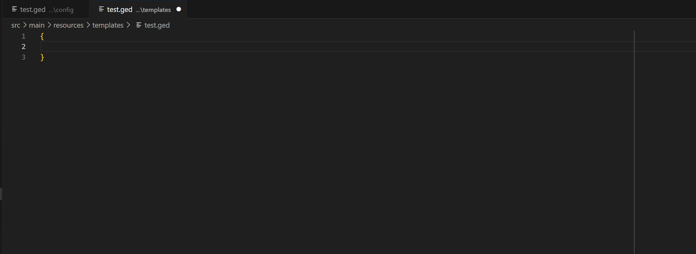
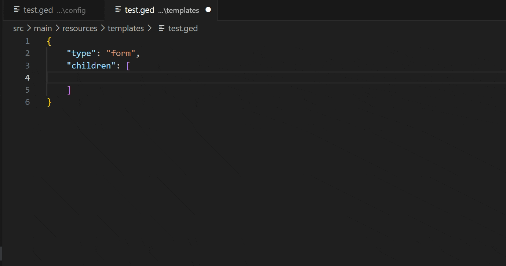
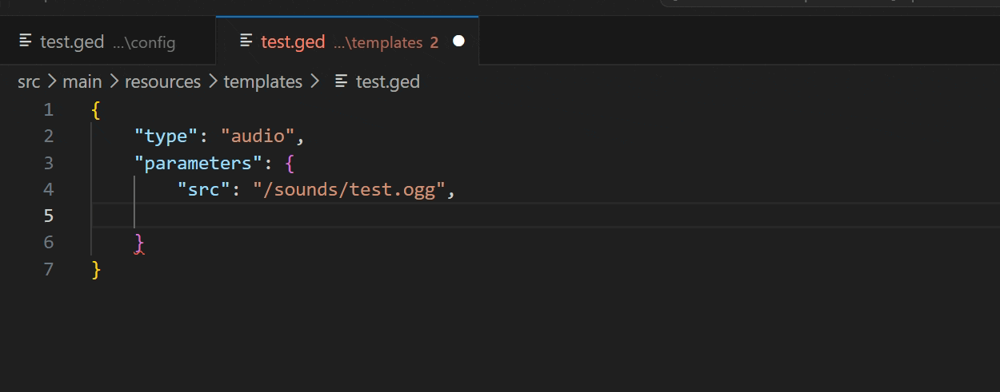
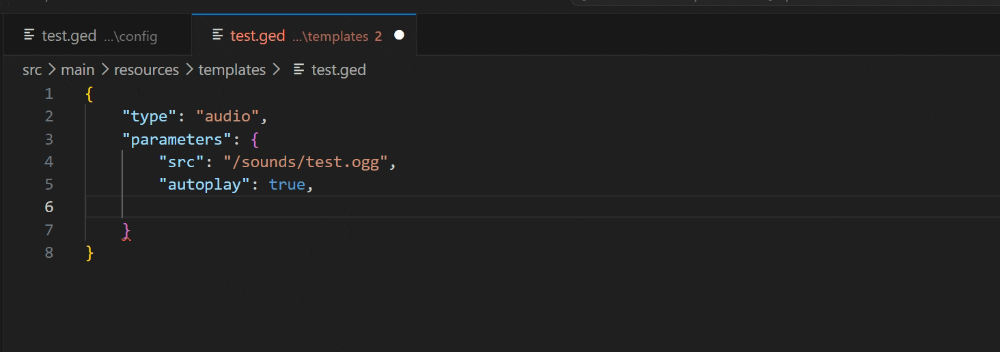
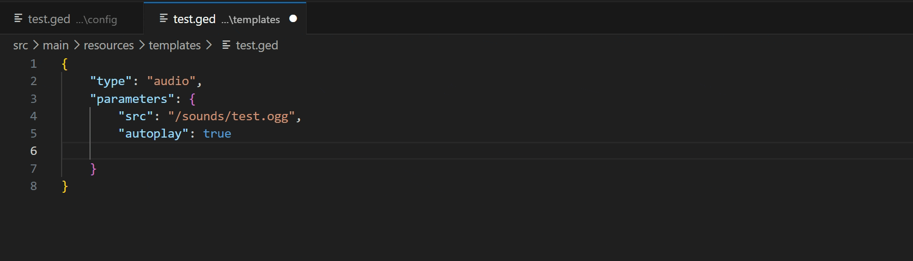
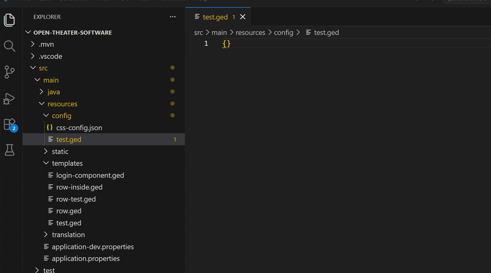

# GED Language Tools

A VS Code extension that adds rich editing for `.ged` files — the JSON-based DSL used by `ci-lib-spring-gui` to define UI templates.

Out of the box, `.ged` files get version-aware validation, context-aware autocomplete, and cross-referencing of `$$value$` / `$$text$` / `$$function$` / `$$class$` replacement tokens against your project's actual Java code and the corresponding `ci-lib-spring-gui` functionalities.

## Features

### Context-aware autocomplete

Completions are driven by a element registry:

- **Type values** > only the types actually allowed as a child at that position (or as a root type)
- **Property keys** > only the properties valid for that specific element
- **Parameter keys** > only the parameters valid for that specific element, inside `"parameters": { ... }`
- **Parameter values** > the declared `enumValues` for that parameter, if applicable
- **New child elements** > a ready-to-use `{ "type": "..." }` snippet for every element allowed at that position

All of the above automatically respect the configured library version.





It also is type aware and flags wrong parameter types. Event parameters (`onClick`, `onInput`, `onKeydown`, `btnLeftFunction`, `btnCenterFunction`, `btnRightFunction`) only accept a `$$function$` token.

> Note: this only works for hardcoded parameter inside the JSON struct. Parameters that get replaced via dynamic `$$value$` placeholders cannot be checked this way.





### Version-aware validation

Every `.ged` file is validated against the element/property/parameter definitions for the `ci-lib-spring-gui` version you're targeting. Elements, properties, parameters, allowed child types, and individual enum values can each be scoped to a specific version range, so using something not supported by the selected version is flagged with a clear message.

``` html
Property "layout" is not available for type "content" in version 3.5 (available from version 4.0).
```



Pick your version from **Settings → GED Language Tools → Library Version**.Switching versions re-validates open files immediately.

### File location warnings

By default, warns if a `.ged` file lives outside `/resources/templates/`, since that's the convention `ci-lib-spring-gui` expects. Configurable per-project.



## Requirements

- VS Code `1.120.0` or later
- No other dependencies — everything ships bundled with the extension

## Extension Settings

| Setting | Type | Default | Description |
| --- | --- | --- | --- |
| `gedLanguageTools.libraryVersion` | `string` (dropdown) | `"4.0"` | The `ci-lib-spring-gui` `.ged` language version to validate and autocomplete against. |
| `gedLanguageTools.enableLocationCheck` | `boolean` | `true` | Warn when `.ged` files are located outside `/resources/templates/`. |
| `gedLanguageTools.ignoredLocationPaths` | `string[]` | `[]` | Additional folder paths (relative or absolute, forward slashes) where `.ged` files are allowed without triggering the location warning. |
| `gedLanguageTools.ignoredPaths` | `string[]` | `[]` | Paths (relative or absolute, forward slashes) whose `.ged` files are not validated at all. Matched as a substring of the full file path. Set it in the workspace settings to apply it per project. |

## How it works, briefly

- `.ged` are JSON files registered under their own `ged` language id.
- Element/property/parameter definitions are defined per version of the library.

## Known limitations

- none

## Release Notes

### 1.0.0

Initial release: version-aware validation for initial library version 4.0.0, context-aware completion, dedicated language id with its own formatter.
